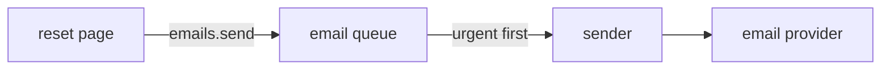

# Design doc template

Read [SKILL.md](../SKILL.md) first: it says what goes in each section and who the owner and the
builder are.

## Write a design doc

1. Copy the block below to `docs/design/<work>.md`, where `<work>` names the work in kebab case,
   such as `urgent-emails.md`.
2. Replace the example values. They describe an invented app.
3. Delete each `<!-- -->` comment.
4. Delete Shape when the design is one function or one type. Delete Out of scope and Open questions
   when they have nothing to say. Keep every other section.
5. Leave file paths out of the text and the code. The builder finds a symbol by name. Links to other
   docs are fine.

Avoid these mistakes:

- prose that retells a contract the Contracts section shows;
- an option the owner turned down, a dated note, or a note addressed to the owner;
- an open question with nothing named to settle it, or one the builder could settle alone.

````markdown
# <Work name>

- **Status:** draft
- **Decision records:** [0012](../decisions/0012-urgent-emails-go-first.md)

<!-- Status is draft until the owner approves the design, then agreed. Decision records lists each record the design links; delete that bullet when there are none.  -->

<!-- The summary: 2 or 3 sentences on what changes, for whom, and the approach in one line. -->

A password reset email waits behind the weekly newsletter, sometimes for an hour. The email queue
gets a priority, so an urgent email goes out before every newsletter email that waits.

## Shape

<!-- One mermaid diagram of the main path, 10 nodes or fewer. Errors and retries go in Constraints. With no flow to show, draw the parts and what each one owns. -->



## Contracts

<!-- The call first, with a result in a comment that matches its type. Then the types, each one defined here or named with the module that owns it. Name the module that owns each new type in a comment. For an HTTP endpoint, show the request and the response in an `http` block. For a table with no SQL settled, list its columns in a `text` block, one per line with the type and a comment. A rule for one field goes in a comment on that field.  -->

```ts
const email = await emails.send({ to, template: 'password-reset', priority: 'urgent' });
// → { emailID: 'e_8f2', queuedAt: '2026-03-02T10:15:00Z' }
//   or { error: 'unknown-template', template: 'pasword-reset' }
```

```ts
// emails module. Adapters: the email provider, and an in-memory fake for tests.
interface EmailQueue {
  send(input: SendEmail): Promise<QueuedEmail | UnknownTemplate>;
  cancel(emailID: string): Promise<void>; // idempotent
}

type SendEmail = { to: string; template: string; priority: 'urgent' | 'bulk' };
type UnknownTemplate = { error: 'unknown-template'; template: string };

interface QueuedEmail {
  emailID: string;
  queuedAt: string; // when the queue took the email
}
```

## Constraints

<!-- The rules the code must keep, one per line, each one a test could check: invariants, limits with numbers, failures and what happens on each, what must never happen. -->

- An urgent email leaves the queue before every bulk email that waits.
- An urgent email reaches the email provider within 1 minute, however many bulk emails wait.
- `cancel` of an unknown or sent email succeeds and changes nothing.
- The queue never drops a bulk email.

## Decisions

<!-- Each choice made between options, one line each: the choice, its reason, and a link to its decision record when one exists. A rule the code must keep goes in Constraints. -->

- **Urgent emails go to the front of one queue.** A second queue needs a second sender.
  [0012](../decisions/0012-urgent-emails-go-first.md)
- **The emails module is the only caller of the email provider.** Two callers can't keep one rate
  limit.

## Builder decides

<!-- What the design leaves to the builder on purpose: names, layout, wording. Keep at least one line, so the owner sees what was left open. -->

- The names of internal functions and files.
- How the queue stores the priority.
- The wording of each error message.

## Out of scope

<!-- What a reader might expect this work to do, and it doesn't, with where it lives or why not. -->

- A second email provider. One provider sends every email.

## Open questions

<!-- Each question: what settles it (the owner, a spike or a measurement), and what the code does until then. When it is settled, move the answer into Decisions and delete the question. -->

- **Is a receipt email urgent?** The owner settles it. Until then, only a password reset is urgent.
````

## Split a long design

Split a design that passes about 400 lines with its code. Cut it where one part calls another
through a contract, so each doc owns the contracts of its part.

1. Make the folder `docs/design/<work>/`, with one doc per part, named after the part, such as
   `queue.md`.
2. Give the folder a `README.md` with the title, the header bullets, the summary, a Shape diagram of
   how the parts connect, a table of the docs, and each decision that spans parts.
3. Give each doc the sections above, with its own Shape diagram and its own header bullets.
4. Add one `../` to each link out of the folder, such as `../../decisions/`.
