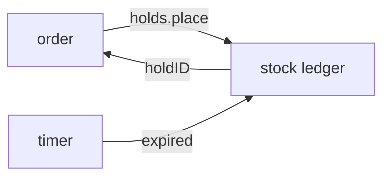

# Design doc template

Copy the block below to `docs/design/<work>.md`, where `<work>` names the work in kebab case, such
as `order-holds.md`. The design doc has two readers: the project owner, who approves the design, and
the builder, the agent or person who implements it. Read [SKILL.md](../SKILL.md) first for what goes
in each section.

Fill the block this way:

- Replace the example values, which describe an invented warehouse service, and delete each
  `<!-- -->` comment.
- Keep the sections in this order. Delete Shape only when one code block shows the whole design, and
  delete Open questions when nothing is open. Keep every other section.
- Leave file paths out everywhere. The builder finds a symbol by name.

Avoid these mistakes:

- a section of prose that retells a contract the Contracts section already shows;
- an option the owner rejected, a date, or a note addressed to the owner;
- an open question with nothing named to settle it, or one the builder could settle alone.

````markdown
# <Work name>

> **Status:** draft · **Decisions:** [0012](../decisions/0012-holds-expire-after-15-minutes.md) ·
> **Touches:** `HoldStore`, `placeOrder`

<!-- Status is draft until the owner approves the design, then agreed. List each decision record this design links, or delete Decisions when it has none. Touches lists the existing symbols the design changes. -->

<!-- 2 or 3 sentences: what changes, for whom, and the approach in one line. -->

Orders hold stock while the buyer checks out, so two buyers can't pay for the last unit. A hold
lives in the stock ledger and expires on its own.

## Shape

<!-- One mermaid diagram of the main path, 10 nodes or fewer. Errors and retries go in Constraints. With no flow to show, draw the parts and what each one owns. -->



## Contracts

<!-- The call first, with a realistic result in a comment, then the types. For an HTTP endpoint, show the request and the response in an `http` block. A rule that belongs to one field goes in a comment on that field. Each block under about 40 lines. -->

```ts
const hold = await holds.place({ orderID, sku: 'BOLT-M6', units: 40 });
// → { holdID: 'h_8f2', expiresAt: '2026-03-02T10:15:00Z' }
//   or { error: 'insufficient-stock', available: 12 }
```

```ts
// holds module. Adapters: SQLite, and an in-memory fake for tests.
interface HoldStore {
  place(input: PlaceHold): Promise<Hold | InsufficientStock>;
  release(holdID: string): Promise<void>; // idempotent
}

interface Hold {
  holdID: string;
  units: number; // > 0
  expiresAt: string; // placed + 15 minutes
}
```

## Constraints

<!-- One checkable rule per line: invariants, limits with numbers, failures and what happens on each, what must never happen. -->

- Held units never exceed the units on the shelf.
- When a hold expires, its units return to the shelf within 1 minute.
- `release` of an unknown or expired hold succeeds and changes nothing.
- When two orders race for the last units, one gets the hold and the other gets
  `insufficient-stock`.

## Decisions

<!-- One line each: the rule, its reason, and a link to its decision record when one exists. A decision record holds a choice the owner approved; see SKILL.md. -->

- **Holds expire after 15 minutes.** A checkout that takes longer has been abandoned.
  [0012](../decisions/0012-holds-expire-after-15-minutes.md)
- **The ledger is the only writer of stock counts.** Two writers drift apart.

## Builder decides

<!-- What the design leaves to the builder on purpose: names, layout, wording. Keep at least one line, so the owner sees what was left open. -->

- The names of internal functions and files.
- How the expiry timer is scheduled.
- The wording of each error message.

## Out of scope

<!-- What a reader might expect here and won't find, with where it lives or why not. -->

- Holds across warehouses. Each warehouse holds its own stock.

## Open questions

<!-- Each question: what settles it (the owner, a spike or a measurement), and what the code does until then. -->

- [ ] **Can staff extend a hold?** The owner settles it. Until then, a hold never extends.
````

## Split a long design

When a design passes about 400 lines with its code, split it into `docs/design/<work>/`, one doc per
part, cut where one part calls another through a contract. Each doc owns the contracts of its part.

- Name each doc after its part, such as `ledger.md` and `expiry.md`.
- Give the folder a `README.md` with the opening, a Shape diagram of how the parts connect, and a
  table of the docs.
- Give each doc the sections above, with its own Shape diagram for its part, and the Status line.
- Add one `../` to each link out of the folder, such as `../../decisions/`.
