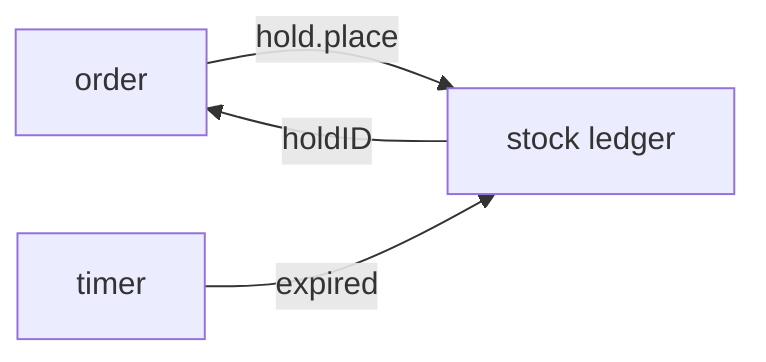

# Design doc template

Copy the block below to `docs/design/<work>.md`, where `<work>` names the work in a few words. Keep
every section in this order. Delete a section only where its comment says you may, and delete every
comment once its section has content.

The example values describe an invented warehouse service that holds stock for an order. Replace
them.

````markdown
# <Work name>

> **Status:** draft | agreed · **Decisions:** [0012](../decisions/0012-<slug>.md) · **Touches:**
> `<symbol>`, `<symbol>`

<!-- 2 or 3 sentences: what changes, for whom, and the approach in one line. Name symbols the design extends in Touches; leave file paths out. -->

## Shape

<!-- One mermaid diagram of the main path, about 10 nodes at most. Errors and retries go in Constraints. -->



## Contracts

<!-- The call first, with a realistic result in a comment. Then the types. A rule that belongs to one field goes in a comment on that field. Each block under about 40 lines. -->

```ts
const hold = await holds.place({ orderID, sku: 'BOLT-M6', units: 40 });
// → { holdID: 'h_8f2', expiresAt: '2026-03-02T10:15:00Z' }
//   or { error: 'insufficient-stock', available: 12 }
```

```ts
// holds module. One adapter per store: SQLite, and an in-memory fake for tests.
interface HoldStore {
  place(input: PlaceHold): Promise<Hold | InsufficientStock>;
  release(holdID: string): Promise<void>; // idempotent
}

interface Hold {
  holdID: string;
  units: number; // > 0
  expiresAt: string; // placed + 15 minutes
}
```

## Constraints

<!-- One checkable rule per line: invariants, limits with numbers, failures and what happens, what must never happen. -->

- Held units never exceed the units on the shelf.
- When a hold expires, its units return to the shelf within 1 minute.
- `release` of an unknown or expired hold succeeds and changes nothing.
- When two orders race for the last units, one gets the hold and the other gets
  `insufficient-stock`.

## Decisions

<!-- One line each: the rule and its reason. Link the decision record when one exists. -->

- **Holds expire after 15 minutes.** A checkout that takes longer has been abandoned. → 0012
- **The ledger is the only writer of stock counts.** Two writers drift apart.

## Builder decides

- The names of internal functions and files.
- How the expiry timer is scheduled.
- The wording of each error message.

## Out of scope

<!-- What a reader might expect here and won't find, with where it lives or why not. -->

- Holds across warehouses. Each warehouse holds its own stock.

## Open

<!-- Delete this section when nothing is open. Each point: who settles it, and what the build does until then. -->

- [ ] **Can staff extend a hold?** The owner decides. Until then, a hold never extends.
````

For a design that passes about 400 lines, split it at a boundary into `docs/design/<work>/`. Give
the folder a `README.md` that holds the opening, the one diagram of the whole and a table of the
docs, and give each doc the sections above.
