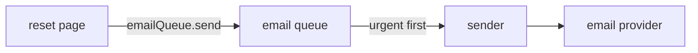

# Design doc template

Copy the template here to write a design doc, split one that grows past about 400 lines, and close
one out once its work items are done. Read [SKILL.md](../SKILL.md) first, for what goes in each
section and for who the owner and the builder are.

- [Write a design doc](#write-a-design-doc)
- [Split a long design doc](#split-a-long-design-doc)
- [Close out a design doc](#close-out-a-design-doc)

## Write a design doc

1. Copy what is inside the block below to `docs/design/<work>.md`. `<work>` names what the work
   items build, in kebab case, such as `urgent-emails`.
2. Replace the example values. They describe an invented app.
3. Delete each `<!-- -->` comment.
4. When the design is one function or one type, delete Shape. When you have nothing to put in Out of
   scope or Open questions, delete that section. Keep every other section.
5. Leave file paths out of the text and the code. The builder finds a symbol by name. Links to other
   docs are fine.

Avoid these mistakes:

- prose that retells a contract the Contracts section shows;
- an option the owner turned down, a dated note, or a note addressed to the owner;
- an open question with nothing named to settle it, or one the builder could settle alone.

````markdown
# <Work name>

- **Status:** draft
- **Decision records:** [0012](../decisions/0012-urgent-emails-go-first.md)

<!-- Status is draft until the owner approves the design, then agreed. Decision records lists each record the design links; delete that bullet when there are none.  -->

<!-- The summary: 2 or 3 sentences on what changes, for whom, and the approach in one line. -->

A password reset email waits behind the weekly newsletter, sometimes for an hour. The email queue
gets a priority, so an urgent email goes out before every newsletter email that waits.

## Shape

<!-- One mermaid diagram of the main path, 10 nodes or fewer. Errors and retries go in Constraints. With no flow to show, draw the parts and what each one owns. -->



## Contracts

<!-- The call first, with a result in a comment that matches its type. Then the types: define each new type here, with the module that owns it in a comment, and name each existing type with the module that owns it. For an HTTP endpoint, show the request and the response in an `http` block. For a table with no SQL settled, list its columns in a `text` block, one per line with the type and a comment. A rule for one field goes in a comment on that field.  -->

```ts
const email = await emailQueue.send({ to, template: 'password-reset', priority: 'urgent' });
// → { emailID: 'e_8f2', queuedAt: '2026-03-02T10:15:00Z' }
//   or { error: 'unknown-template', template: 'password-reset' }
```

```ts
// emails module. Adapters: the email provider, and an in-memory fake for tests.
interface EmailQueue {
  send(input: SendEmail): Promise<QueuedEmail | UnknownTemplate>;
  cancel(emailID: string): Promise<void>; // idempotent
}

type SendEmail = { to: string; template: string; priority: 'urgent' | 'bulk' };
type UnknownTemplate = { error: 'unknown-template'; template: string };

interface QueuedEmail {
  emailID: string;
  queuedAt: string; // when the queue took the email
}
```

## Constraints

<!-- The rules the code must keep, one per line, each one a test could check: invariants, limits with numbers, failures and what happens on each, what must never happen. -->

- An urgent email leaves the queue before every bulk email that waits.
- An urgent email reaches the email provider within 1 minute, however many bulk emails wait.
- `cancel` of an unknown or sent email succeeds and changes nothing.
- The queue never drops a bulk email.

## Decisions

<!-- Each choice made between options, one line each: the choice, its reason, and a link to its decision record when one exists. A rule the code must keep goes in Constraints. -->

- **Urgent emails go first, in one queue.** One queue keeps one rate limit with the email provider.
  [0012](../decisions/0012-urgent-emails-go-first.md)
- **The emails module is the only caller of the email provider.** One caller can count every email
  that goes out.

## Builder decides

<!-- What the design leaves to the builder on purpose: names, layout, wording. Keep at least one line, so the owner sees what was left open. -->

- The names of internal functions and files.
- How the queue stores the priority.
- The wording of each error message.

## Out of scope

<!-- What a reader might expect these work items to do, and it doesn't, with where it lives or why not. -->

- A second email provider. One provider sends every email.

## Open questions

<!-- Each question: what settles it (the owner, a spike or a measurement), and what the code does until then. When it is settled, move the answer into Decisions and delete the question. -->

- **Is a receipt email urgent?** The owner settles it. Until then, only a password reset is urgent.
````

## Split a long design doc

Split a design doc that grows past about 400 lines, code blocks included, into one doc per
[part](../SKILL.md#choose-where-the-design-goes). Cut it where one part calls another through a
contract. Put each contract in the doc of the part that owns it.

1. Make the folder `docs/design/<work>/`, with one doc per part, named after the part, such as
   `emails.md`.
2. Give the folder a `README.md` that holds:
   - the title, the header bullets and the summary;
   - a Shape diagram of how the parts connect;
   - a table of the docs;
   - each decision that spans parts.
3. Give each part's doc the sections of the template in [Write a design doc](#write-a-design-doc),
   kept or deleted as its step 4 says, with its own header bullets, summary and Shape diagram.
4. Add one `../` to each link out of the folder, such as `../../decisions/`.

## Close out a design doc

A design doc lasts only until its work items are done. When the last work item that the design doc
covers is done, the agent that finishes it closes out the design doc:

1. Move each fact that still describes the system into the doc in `docs/architecture/` that covers
   that part of the system.
2. Check that each choice that passes the three decision-record tests in
   [Write a decision record](../SKILL.md#write-a-decision-record) has a record.
3. Delete the design doc, or the whole folder of a split design. Point each link to it at the
   architecture doc from step 1.
